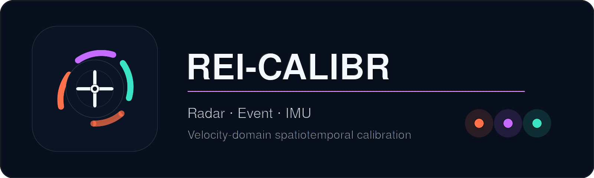
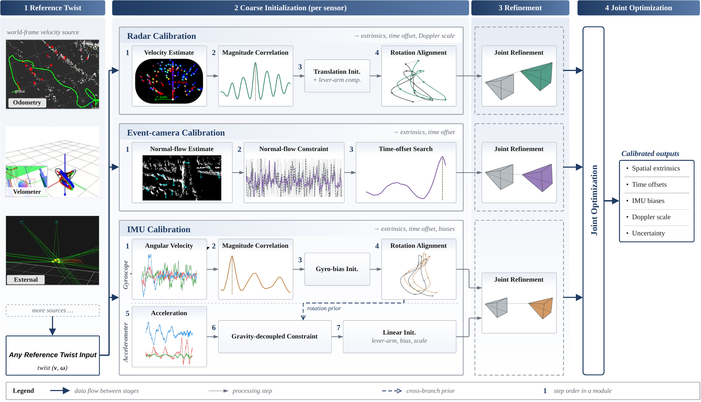
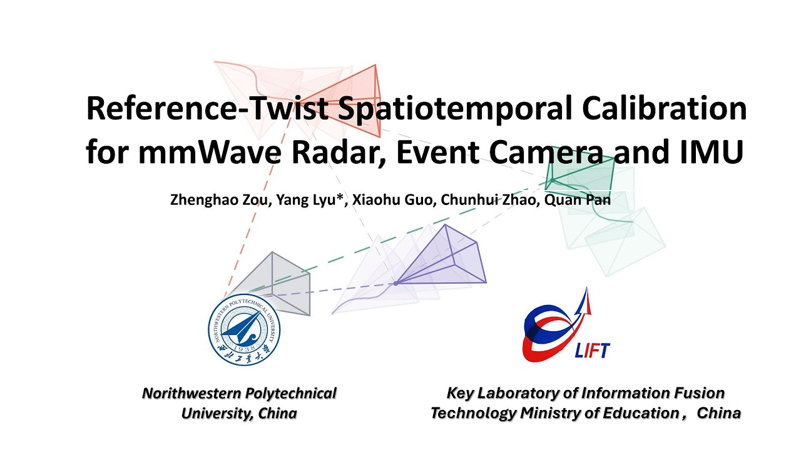

<p align="center">
  
</p>

<p align="center">
  <a href="https://github.com/ZzhYgwh/REI-Calibr/actions/workflows/ci.yml"></a>
  
  <a href="LICENSE"></a>
  <a href="https://github.com/ZzhYgwh/REI-Calibr-Frontend"></a>
  <a href="https://arxiv.org/abs/2611.26083"></a>
  <a href="https://www.youtube.com/watch?v=mXS583RE3yQ"></a>
</p>

# REI-Calibr

**REI-Calibr** is the execution code for velocity-domain spatiotemporal calibration of a **radar**, an **event camera**, and an **IMU** against a fixed reference twist. It estimates each sensor's rotation, translation, time offset, and modality-specific nuisance parameters without requiring sensor-to-sensor feature associations.

This repository contains the runnable Python pipeline, the final reference configurations, a compact result summary, and a ROS 1 frontend submodule for motion-cue extraction. Raw recordings, generated experiment folders, intermediate files, and the manuscript are **not** included.

## Framework

<p align="center">
  
</p>

The framework calibrates radar, event-camera, and IMU motion cues against an arbitrary reference twist through coarse initialization, per-sensor refinement, and optional joint optimization.

## Highlights

- Rigid-body velocity residual with the lever-arm term: `R_BR v_R = s (v_B + ω_B × p_BR)`.
- Independent radar, event, and IMU stages followed by an optional joint refinement.
- Coarse-to-fine time-offset estimation and robust Huber/soft-L1 optimization.
- Reusable YAML configuration with CLI overrides and one-stage execution.
- Reproducible manifests (`calibration_session.json`, `resolved_config.yaml`) and per-stage diagnostics.

## Video

<a id="video"></a>

[](https://www.youtube.com/watch?v=mXS583RE3yQ)

[Watch the illustrative video on YouTube](https://www.youtube.com/watch?v=mXS583RE3yQ)

## Method

For a sensor `S ∈ {R, E, I}` rigidly attached to the calibration body `B`, the pipeline relates the sensor-frame velocity observation to the reference body twist:

```text
v_S = s_S · R_BRᵀ (v_B + ω_B × p_BS) + b_S
t_B = t_S - tau_S
```

The unknowns are estimated from angular excitation in the reference trajectory:

- `R_BS`, `p_BS`: spatial extrinsic parameters.
- `tau_S`: sensor-minus-body time offset.
- `s_S`: optional Doppler scale.
- `b_S`: optional radar bias or IMU gyro bias.

The radar, event, and IMU stages share the same reference twist but keep modality-specific residuals. See `docs/RESULTS.md` for the spatial/time conventions used in the reported output.

## Repository Layout

```text
.
├── assets/                 # Project banner and logo
├── calibr_tools/velocity/  # Modular calibration pipeline
├── configs/                # Sanitized final configurations
├── docs/                   # Input format and compact results
├── frontend/               # ROS 1 radar/event/IMU motion-cue frontend (Git submodule)
├── scripts/                # Synthetic example, single-sequence/batch runners, aggregation
├── CITATION.cff            # Citation metadata
├── LICENSE                 # MIT for the Python pipeline
├── pyproject.toml          # Package metadata
└── requirements.txt        # Runtime dependencies
```

## Installation

The code requires Python 3.8 or newer and works on CPU only.

```bash
git clone --recurse-submodules https://github.com/ZzhYgwh/REI-Calibr.git
cd REI-Calibr

python3 -m venv .venv
source .venv/bin/activate
python3 -m pip install --upgrade pip
python3 -m pip install -r requirements.txt
```

Optional editable install:

```bash
python3 -m pip install -e .
```

Core dependencies: `numpy`, `scipy`, `PyYAML`, and `matplotlib`.

## ROS Frontend

The motion-cue frontend is maintained in the standalone [REI-Calibr-Frontend](https://github.com/ZzhYgwh/REI-Calibr-Frontend) repository and vendored here as the `frontend/` Git submodule. It extracts radar Doppler velocities and event-camera normal flow, and it buffers/interpolates IMU measurements for those motion estimators. It stops before the back-end optimization.

If the main repository was cloned without submodules, run:

```bash
git submodule update --init --recursive
```

The frontend targets ROS 1 Noetic and requires `dvs_msgs` in the same catkin workspace. Build it with:

```bash
mkdir -p ~/rei_frontend_ws/src
ln -s "$(pwd)/frontend" ~/rei_frontend_ws/src/rei_calibr_frontend
cd ~/rei_frontend_ws
catkin_make -DCMAKE_BUILD_TYPE=Release
source devel/setup.bash
```

The only launch entry point is `out.launch`:

```bash
roslaunch rei_calibr_frontend out.launch \
  output_dir:=$HOME/rei_frontend_output \
  start_rviz:=false
```

See [`frontend/README.md`](frontend/README.md) for dependencies, topic mappings, output file formats, and the raw-data replay workflow.

## Data

### Raw recordings

The raw radar-event-IMU recordings are distributed separately on Google Drive:

**[Raw recordings](https://drive.google.com/drive/folders/11vWLF8X6Cd7w-J2NAtEPvszvG5DYo0Hy?usp=drive_link)**

These files are the original sensor logs. Use the [ROS frontend](https://github.com/ZzhYgwh/REI-Calibr-Frontend) and `frontend/launch/out.launch` to extract radar velocities, event normal flow, and IMU-dependent motion estimates from them. Raw bags are not tracked in this repository or its submodule.

### Calibration inputs

The processed frontend data used as input to the Python calibration pipeline are also available separately:

**[Frontend-processed calibration inputs](https://drive.google.com/drive/folders/1pBN6QWuz3XEVE6UZTKoemDToQXk3U_Nt?usp=drive_link)**

Place one calibration-input directory in `data/sequence/`. The minimum radar-only setup is:

```text
data/sequence/
├── gt.twist          # reference twist
└── radar_vel.tum     # radar-frame velocity
```

The full setup also uses `aid_radar_vel.tum`, `debug_flows.csv`, `livox_imu.csv`, and `dvs_imu.csv`. See [`docs/DATA_FORMAT.md`](docs/DATA_FORMAT.md) for the column conventions and optional radar diagnostics.

The linked calibration-input bundle is the reproducible input source for the Python pipeline. Regenerating every file from the raw recordings requires the corresponding ROS drivers, topic mappings, and the frontend configuration used for the experiment.

## Running

### Radar-only quick start

No private recording is needed for a first smoke test. Generate a small synthetic radar sequence:

```bash
python3 scripts/make_synthetic_example.py --output data/example
```

Then run:

```bash
python3 -m calibr_tools.velocity.pipeline \
  --config configs/radar_only.yaml \
  --data-dir data/example \
  --output outputs/example
```

Or use the wrapper:

```bash
./scripts/run_sequence.sh configs/radar_only.yaml data/example outputs/example
```

### Full radar–event–IMU pipeline

```bash
python3 -m calibr_tools.velocity.pipeline \
  --config configs/full_pipeline.yaml \
  --data-dir data/sequence \
  --output outputs/full_pipeline
```

### Run a single stage

```bash
python3 -m calibr_tools.velocity.pipeline \
  --config configs/full_pipeline.yaml \
  --data-dir data/sequence \
  --output outputs/radar_only \
  --stage radar_main
```

### Batch processing

```bash
./scripts/run_batch.sh data configs/full_pipeline.yaml outputs
```

Each subdirectory of `data/` that contains `gt.twist` is treated as one sequence.

### Override configuration without editing YAML

```bash
python3 -m calibr_tools.velocity.pipeline \
  --config configs/radar_only.yaml \
  --data-dir data/sequence \
  --output outputs/sequence \
  --set stages.0.optimization.scale_mode=global \
  --set stages.0.time.max_lag_sec=1.0 \
  --set stages.0.optimization.max_nfev=500
```

## Configuration

- `configs/radar_only.yaml`: minimal single-radar calibration and the recommended starting point.
- `configs/full_pipeline.yaml`: final five-stage configuration plus joint refinement, using neutral `data/sequence/` placeholders.

Important configuration groups:

| Group | Purpose |
| --- | --- |
| `reference` | Reference twist file (`t vx vy vz wx wy wz`). |
| `inputs` | Sensor files and column slices. |
| `preprocessing` | Edge trimming, low-pass filtering, radar quality masks, and outlier rejection. |
| `time` | Coarse alignment, search range, and optional initial offset. |
| `optimization` | Robust loss, residual scale, iteration limit, scale mode, and parameter bounds. |
| `diagnostics` | Plot and summary generation. |

## Outputs

The main output directory contains:

```text
outputs/<run>/
├── calibration_session.json
├── resolved_config.yaml
├── summary.md
└── <stage>/
    ├── <stage>_result.json
    ├── stage_summary.md
    ├── *_residuals.csv
    ├── *_debug.csv
    └── *.png
```

The result JSON records the estimated sensor-to-body transform, time offset, scale/bias, residual statistics, and the frame convention. `summary.md` is the compact human-readable report.

To combine several completed run roots:

```bash
python3 scripts/aggregate_results.py outputs/run_a outputs/run_b \
  --continue-seq \
  -o outputs/aggregate.md
```

## Representative Result

The following single-sequence snapshot is included for orientation only; raw data and intermediate files are not distributed. Full details and the CAD sanity check are in [`docs/RESULTS.md`](docs/RESULTS.md).

| Stage | Residual RMS | `tau` (s) | `p_GT_sensor` (m) |
| --- | ---: | ---: | --- |
| `radar_main` | 0.1511 | -0.532916 | `[0.135189, -0.0310358, 0.037504]` |
| `aid_radar_main` | 0.12071 | -0.534487 | `[0.135417, -0.0372424, 0.075781]` |
| `event_main` | 0.11232 | -0.562357 | `[0.105259, 0.00630348, 0.0155143]` |
| `livox_imu_main` | 0.063022 | -0.005838 | `[0.0819858, 0.00821753, 0.105339]` |
| `dvs_imu_main` | 0.060671 | -0.768396 | `[0.0918803, 0.00665832, 0.0244585]` |

Residual RMS is in the native unit of each stage. Compare values within a modality rather than across modalities.

## Citation

If you use this code, please cite the accompanying paper:

Z. Zou, Y. Lyu, X. Guo, C. Zhao, and Q. Pan, “Reference-Twist-Based Velocity-Domain Spatiotemporal Calibration for mmWave Radar, Event Camera, and IMU,” arXiv preprint arXiv:2611.26083, 2026.

**arXiv reference format**

> Z. Zou, Y. Lyu, X. Guo, C. Zhao, and Q. Pan, “Reference-Twist-Based Velocity-Domain Spatiotemporal Calibration for mmWave Radar, Event Camera, and IMU,” arXiv preprint arXiv:2611.26083, 2026.

**BibTeX**

```bibtex
@misc{zou2026reference,
  author        = {Zou, Zhenghao and Lyu, Yang and Guo, Xiaohu and Zhao, Chunhui and Pan, Quan},
  title         = {Reference-Twist-Based Velocity-Domain Spatiotemporal Calibration for mmWave Radar, Event Camera, and IMU},
  year          = {2026},
  eprint        = {2611.26083},
  archivePrefix = {arXiv},
  primaryClass  = {cs.RO},
  url           = {https://arxiv.org/abs/2611.26083}
}
```

Paper: [arXiv:2611.26083](https://arxiv.org/abs/2611.26083)

## License

The Python pipeline in this repository is released under the [MIT License](LICENSE). The ROS frontend submodule is released under **GPL-3.0-only** because some parameter utilities are derived from GPL-3.0 LI-Calib code; see [`frontend/LICENSE`](frontend/LICENSE).
